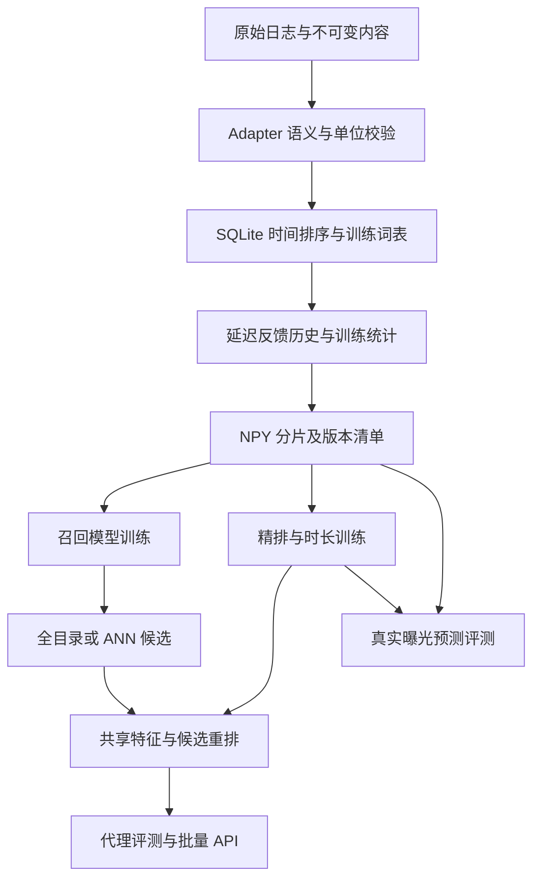

# v2 架构与数据流

v2 采用 `seqrank.research` 命名空间，避免破坏原有 `data.py/models.py` 的导入与旧 checkpoint。v1 架构原文保存在 `ARCHITECTURE_V1.md`，其中历史测试结论不适用于 v2。

| 文件 | 职责 | 重要依赖 |
|---|---|---|
| adapters.py | CSV/Parquet、KuaiRand、可选不可变内容 SQLite join | 不依赖模型 |
| dataset.py | global split、词表、历史、NPY、manifest | adapters、features、旧 mmap Dataset |
| features.py | 同一 dense 特征、标准化、候选展开 | numpy/torch |
| networks.py / retrievers.py | 神经模型、稀疏基线、检索与索引 | 旧 BOS SequenceEncoder |
| watchtime.py / objectives.py | train-only 目标变换、所有 loss numerator/count | 模型无数据加载逻辑 |
| training.py | CPU/DDP/AMP/累积、验证选模、epoch 恢复 | objectives |
| metrics.py / evaluation.py | 磁盘精确排序与三种评测协议 | serving 与其共用 rerank |
| serving.py | 请求校验、raw ID lookup、batch predict/recommend | features、evaluation、load_checkpoint |
| diagnostics.py / experiments.py | 无污染梯度诊断、矩阵与结果汇总 | 正常训练/评估入口 |

离线单曝光和 `/predict` 使用请求中的 duration/category；候选生成和 `/recommend` 使用训练目录中最早曝光记录的内容快照。两类问题都复用相同计算函数，不能将未知候选的事后标签或未来 metadata 加入特征。若内容属性可变，需要上游时点 join；当前不可变内容 join 要求显式确认。

## 资源边界

- 数据转换流式读取，内容 join/事件排序在 SQLite；预处理缓冲最多三个 shard。每条记录存 item/watch/duration/time 四条历史，存储约 O(NL)。慢磁盘、SQLite 排序临时空间会成为瓶颈。
- mmap 按需打开最多 8 个 shard，继承 v1 worker-safe reopen。`DistributedSampler` 仍维护 O(N) 索引，并为各 rank 等长补齐少量重复训练样本；验证不补齐、不重复。
- 神经 embedding、优化器与 DDP 都是全量副本，未做 embedding sharding。AdamW 为 dense 参数更新；大词表内存成本很高。
- 精确 Top-K 分块但总计算量仍随目录线性增长。默认不屏蔽已看物品，允许重复消费；开启 exclude_seen 会改变评测目标覆盖。
- ItemKNN 保存正样本 user-item 边、稀疏相似度，分块降低中间矩阵大小；仍不保证亿级内存可承受。
- serving 重用历史 embedding 后按候选块计算目标注意力。显式批量接口最多 64 请求；无动态 batching/鉴权/分布式特征服务。HNSW 使用 CPU，包含设备向量搬运。

checkpoint 绑定数据 manifest fingerprint；manifest 绑定配置、原始文件 hash、词表/特征/目录 hash 和 shard hash。`verify-data` 额外扫描全量 shards；正常加载检查目录/词表等资产。ANN 绑定 checkpoint bytes hash、dataset hash、metric/dim/offset、index bytes hash。模型更新后必须重建。
