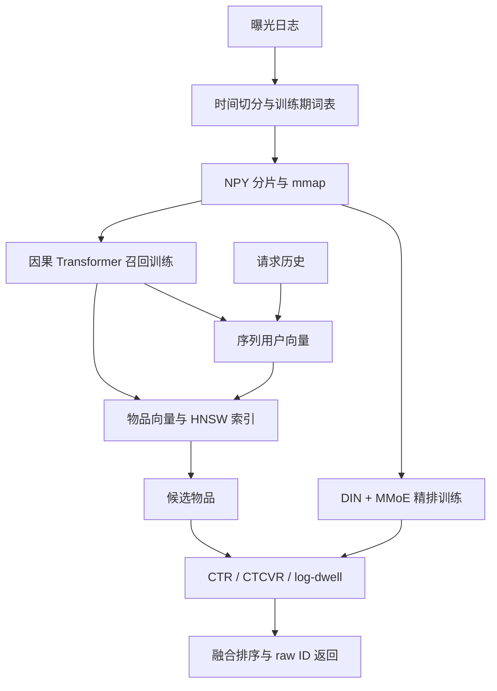

# 架构与设计取舍

## 数据与泄漏

全局时间切分而非逐用户 leave-one-out，避免训练集看到其他用户未来的信息。训练期曝光拟合词表，对未知物品不利用测试期目录。时间相同的用户行为批次先输出样本、下一时间再合入历史。验证/测试采用事件时序更新历史，但不反向传播。

该实现只记录 item 点击序列；没有行为类型、间隔时间、类别或内容编码，没有 point-in-time 特征库。加入新的业务特征时必须保证事件时间可用性。

## 损失

召回使用当前点击为正样本，对每个曝光采样 K 个不同于目标的均匀负例（允许负例重复）。这是二元 logistic 损失，不是 sampled-softmax，也没有全量 softmax 的无偏估计保证。历史点击可能再次被推荐，不作为永久排除项。未点击曝光不贡献召回损失。

精排输入 `[user, target, interest, target*interest]`。每个任务通过自己的 softmax 门控加权共享专家，三个 tower 输出 CTR logit、CVR logit 和非负 log-dwell。

`L = BCE(click, CTR) + λc * masked_BCE(conversion, CTR*CVR) + λd * masked_Huber(log1p(dwell), predicted_log_dwell)`。

未知标签为 -1；dwell 只在点击曝光上监督。所有 loss 均以曝光 batch 大小为分母，因此辅助任务权重也受有效标签率影响；这是为了让 DDP 每个 rank 的固定 batch 梯度平均与全局样本加权一致。验证最后一个不满 batch 按样本数加权。

联合概率的 log-loss 在 log 域计算，避免直接相乘后下溢；在极端置信度处截断，确保数值有限。

## 大规模机制与实际瓶颈

- SQLite 使用磁盘排序，预处理不把全部曝光日志放入 Python 列表；NPY shard buffer 内存受 shard_size 和 max_len 控制。
- 单条历史使用固定长度数组，空间约 `N*(8L+36)` 字节，千万曝光、L=200 约 16.36GB，不含数据库/排序临时空间。
- mmap 按需读，进程缓存最多 8 个分片；分片过碎加随机访问会降低吞吐，需按存储系统实测调整。
- PyTorch RandomSampler / DistributedSampler 的索引排列仍是 O(N) 内存；亿级数据应替换为分片级/块级 shuffle iterable pipeline。
- 精确检索分块避免 B×全目录分数矩阵，分数内存 O(B*chunk)，算力仍 O(B*I*d)。模型物品 embedding 仍需完整驻留。
- FAISS HNSW 减少在线检索计算；索引是 RAM 常驻，非分布式向量库；更新模型后必须重建，不能混用旧索引。
- DDP 复制完整 embedding/优化器，**不是** embedding 参数分片。千万级用户/物品请评估每张卡内存；进一步使用 TorchRec/FSDP/参数服务器需另行实现。
- Transformer attention 为 O(L²)；当前不是超长序列线性注意力模型。
- FastAPI 为同步单请求推理，没有动态 batching、请求队列、缓存或自动降级。benchmark 是进程内 TestClient 延迟，不是生产 HTTP QPS。
- 只有 SQLite ID mapping；不包含 Kafka/Flink/Redis 在线特征服务，历史由调用方提供。

## 验证矩阵

| 验证 | 覆盖 |
|---|---|
| 时间切分 | 同时间戳隔离、未知物品、训练期词表 |
| 模型 | 因果不看未来、空历史、缺失标签、极端 logits |
| 检索 | 分块 top-k 与 dense 一致、小目录 HNSW 一致、版本不匹配拒绝 |
| 生命周期 | 训练→加载→评估→API、checkpoint 恢复入口、参数校验 |
| 分布式 | 无重复验证 sampler 已测；GitHub CI 双进程 CPU DDP 已通过，GPU 待验证 |

## 面试表达与下一步

可陈述“实现了带时间隔离、分片读取、序列召回、MMoE 多任务精排和在线 API 的可复现推荐工程”。
在真实实验完成前不能陈述“支撑亿级数据/百万 QPS/CTR 提升 X%”。要补齐的实验是：真实数据切分统计、多 seed 主表、消融、训练显存与吞吐、ANN 准确率/延迟权衡、冷用户与新物品分群结果。

可深入讨论：为什么不能用负采样 CTR 当真实 CTR、精排无法找回召回漏掉的目标、ESMM 为什么不用只在点击集上训练 CVR、辅助目标缺失如何屏蔽、DDP 梯度的分母如何一致、时间切分和 rolling-history 的评估含义。
